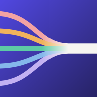

<p align="center">  </p>

# Loom

A life dashboard you install on your phone as a PWA: this week's habits, how they compare with last week, and your goals.

Loom is where habit days live. **Your automations do the tracking**: an n8n workflow (or anything else that can make HTTP requests) works out each habit's status from the sources you connect, such as a calendar, a fitness app or a phone shortcut, and copies your goals in from wherever you keep them. When an automation gets a day wrong, or something wasn't recorded, you fix it in the app: tap a day and pick a status.

```
Calendar, apps, shortcuts ─▶ automation ─▶ PUT /api/days/...   ─▶ SQLite ─▶ GET /api/week ─▶ PWA
Goal tracker              ─▶ automation ─▶ PUT /api/goals/...  ─┤
Corrections in the app                  ─▶ PUT /api/days/...   ─┘
```

Loom has no login of its own. Put it behind an access proxy such as Cloudflare Access, which is what protects edits made in the app, and let your automations call it over a private network.

## Install

Run `ghcr.io/agusespa/loom` (amd64 and arm64; tags `:X.Y.Z`, `:X.Y` and `:latest`). The version shows in the footer. The image runs as distroless `nonroot` (uid 65532), so the data directory must be owned by that user.

## Data model

**Habits** have a key, a name, a position, `plannable` and `archived`. Plannable habits (say, a workout you schedule) can be `planned`, `done` or `missed` and count toward adherence. Other habits (say, a daily walk) are only ever `done`. Habits are never deleted: an archived habit leaves the dashboard (grid, adherence, insights) but keeps its history.

**Habit days** hold a `status` per habit per tracker day, and a `source` saying who set it: `app` for a correction made in the PWA, or `n8n` for an automation. Loom works the source out itself (browsers send `Sec-Fetch-Site`, and the access proxy adds the signed-in user; automations carry neither), so clients can't claim one. A blank day has no row. The tracker day runs from 05:00 to 05:00 (`DAY_START_HOUR`), so something done after midnight still counts for the day before. Your automations decide which date something belongs to. Loom uses the boundary only to know which day is "today".

The tables are `STRICT` and carry their own checks (key and date formats, ranges, allowed values), so a bad write is refused even if it gets past the Go validation.

**Goals** are read-only copies of two lists you keep elsewhere: short-term goals and perennial goals. Progress is a number from 0 to 1. Tapping a goal opens its `url`.

**Adherence** is done / (done + missed) over the plannable habits for the week. It stays empty until something planned has been done or missed.

## API

Every request that changes data refuses browser requests from other sites (`Sec-Fetch-Site`). Unknown JSON fields are rejected.

| Method | Path | Body | Notes |
|---|---|---|---|
| `GET` | `/api/week?start=YYYY-MM-DD` | | `start` must be a Monday. Without it, you get the current week. |
| `PUT` | `/api/days/{date}/{habit}[?if=blank,planned]` | `{"status": "done"}` | Sets the day; `null` clears it. With `?if=`, it writes only when the current status is one of those listed (`blank` = none). Answers `{"date", "habit", "status", "applied"}`. |
| `DELETE` | `/api/days/{date}/{habit}` | | Same as PUT with `null`. |
| `GET` | `/api/days?status=planned&before=YYYY-MM-DD` | | Logged days with that status, oldest first. `before` is optional and exclusive. |
| `PUT` | `/api/goals/{short_term\|perennial}` | `{"goals": [{"id", "name", "type", "priority", "progress", "due", "url"}]}` | Replaces that list. `priority` is `high`, `mid` or `low`, and `due` is `YYYY-MM-DD`. |
| `GET` | `/api/goals/{list}` | | |
| `GET` / `PUT` | `/api/habits`, `/api/habits/{key}` | `{"name", "position", "plannable", "archived"}` | Add, rename or archive a habit. |
| `GET` | `/api/healthz`, `/api/readyz` | | `loom healthcheck` probes readiness. |

### From an automation

In n8n, use an **HTTP Request** node against Loom's address on your network, for example `http://loom:8080`. Typical jobs:

- **Plan the day** (at the start of the tracker day): for each plannable habit scheduled today, `PUT /api/days/{{today}}/{habit}?if=blank` with `{"status": "planned"}`.
- **Close past days** (same job): `GET /api/days?status=planned&before={{today}}` and, for each day, `PUT ...?if=planned` with `{"status": "missed"}` if it was still scheduled, or `{"status": null}` if it was moved or cancelled.
- **Record what happened** (from a webhook, an app or a shortcut): `PUT /api/days/{{date}}/{habit}` with `{"status": "done"}`. No condition: done replaces planned or missed, since it's always right once it happened.
- **Sync goals** (on a schedule): read your goal tracker, map its fields to Loom's, and `PUT /api/goals/short_term` and `/api/goals/perennial` with the whole list.

The scheduled jobs use `?if=` so they never undo a day you corrected by hand.

## Configuration

| Env | Default | |
|---|---|---|
| `PORT` | `8080` | |
| `DB_PATH` | `data/loom.db` | `/app/data/loom.db` in the image |
| `TIMEZONE` | `Europe/Stockholm` | Decides which day is "today" |
| `DAY_START_HOUR` | `5` | When the tracker day rolls over |
